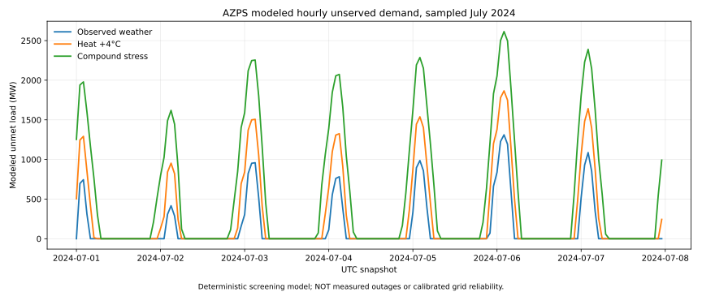
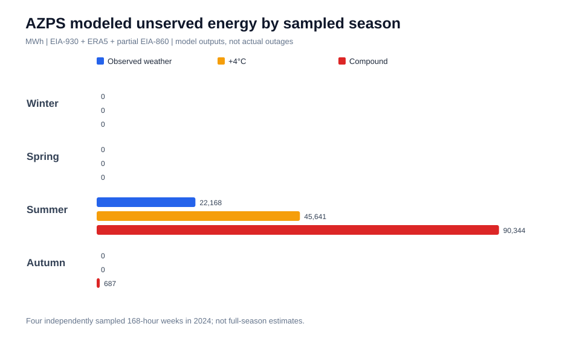
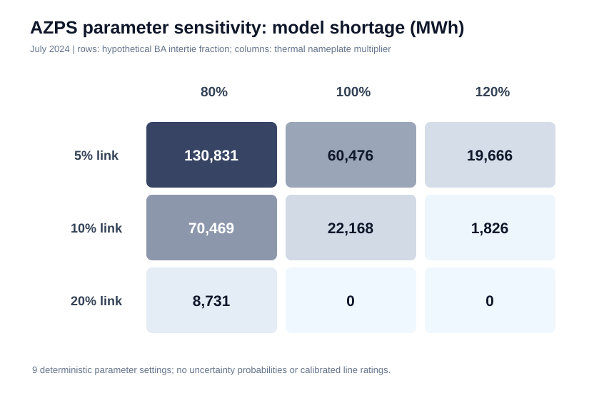
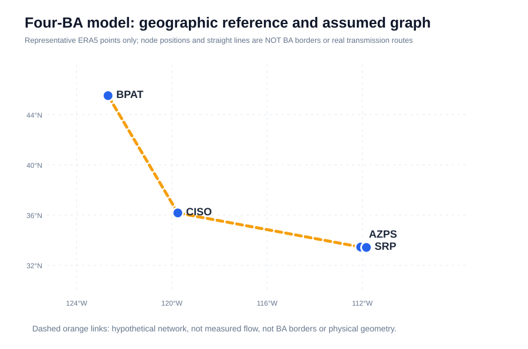
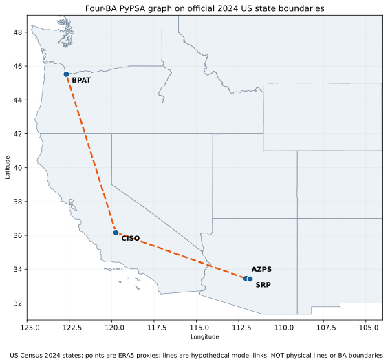
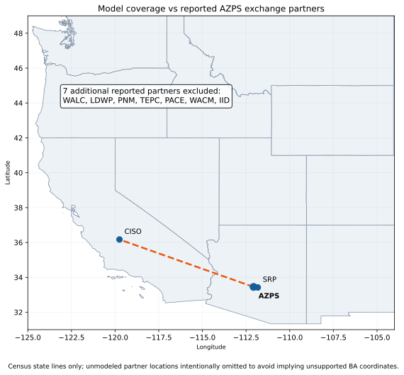
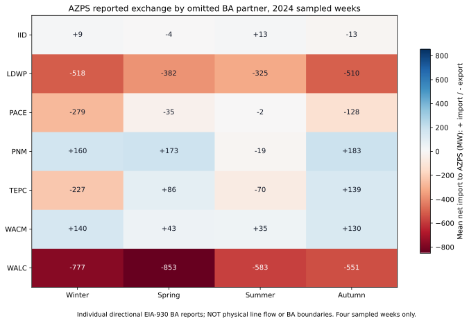

# Climate–Grid Resilience: Verified Portfolio Research Summary

**Scope:** Four balancing authorities (CISO, AZPS, BPAT and SRP), with an original three-BA control. This is a **screening model** of four selected BAs, not the Western Interconnection as a whole.

## Figures and illustrative geography

The hourly line plot is generated from solved PyPSA network output, with three scenario series. It is **not a record of actual outages**.

The following SVGs are versioned in Git and render directly in GitHub.

**Map limitation:** Representative sampling point locations only, not balancing-authority boundaries or physical transmission line paths. **Chart limitation:** Numbers are verified deterministic model outcomes, not historical blackouts.

### Geographic figures with 2024 US Census state boundaries

**Geographic evidence boundary:** Census state outlines are geographic data; BA dots are representative ERA5 sampling coordinates, not actual BA footprints. Dashed model edges are schematic and partner locations are not fabricated. Seasonal annotations represent separate sampled weeks rather than entire seasons.

### Verified partner-by-season exchange direction

The underlying [audited per-partner CSV](../data/verified/seasonal_partner_exchange.csv) preserves per-partner sign; positive values are imports to AZPS and negative values exports from AZPS. The overall combined outside-boundary net export **does not** imply every reported counterpart is an export destination.

## Research questions

1. How sensitive are modeled hourly resource-adequacy shortages to stylized hot-weather and compound stress?
2. How does explicit representation of SRP affect the AZPS result, when artificial unmet-load sources cannot be exported?
3. How much do hypothetical network constraints, omitted AZPS interchange counterparts, seasonal sampling and thermal-nameplate assumptions influence results?

## Input provenance and what is observed

- **EIA-930** hourly BA demand, net generation (NG) and directional bilateral interchange; verified hourly observations and accounting consistency.
- **EIA-860 2024** operational year-end generator nameplate mapped to BA and technology; this is *not* hourly derated/firm available MW. Generator-only screening excludes storage and unsupported categories.
- **ERA5 via Open-Meteo** historical hourly temperatures, 100 m wind speed and shortwave radiation at BA proxy coordinates; these are historical weather proxies, not a future climate projection or plant-level weather.
- **PyPSA/HiGHS** linear deterministic dispatch optimization. Stylized demand response, wind availability, heat derating, marginal operating costs and BA link constraints are **assumptions**. The model is not AC power flow and has no physical transmission ratings or storage energy-conservation constraints.

## Representative verified numerical results

### Four-BA modeled AZPS unserved energy (MWh)

| 2024 sampled week | Observed weather | Heat +4°C | Compound weather stress |
|---|---:|---:|---:|
| Winter (Jan 15–21) | 0 | 0 | 0 |
| Spring (Apr 15–21) | 0 | 0 | 0 |
| Summer (Jul 1–7) | 22,168.29 | 45,640.99 | 90,343.96 |
| Autumn (Oct 14–20) | 0 | 0 | 687.25 |

Source: [verified four-season model workflow](https://github.com/ys30/Climate-Grid-Resilience-PyPSA/actions/runs/40994939078) and [analysis report](2024-four-season-four-ba-adequacy-verified.md). **Four sampled weeks, not full seasonal estimates.**

### Mechanism and model-boundary sensitivity

- Under historical July weather, matched three-BA versus four-BA AZPS modeled shortfall is approximately **60,359 versus 22,168 MWh**. The SRP generator fleet and hypothetical AZPS–SRP connection **must both be present** for this structural effect. [Four-BA mechanism test](2024-07-srp-mechanism-corrected-verified.md).
- July EIA-930 reported AZPS imports from SRP average **~4,536 MW**. The baseline model's assumed AZPS–SRP link limit is only **~798 MW**; observed interchange is *not* a line rating. Thus the model **fails to reproduce observed interchange magnitudes**. [Flow mismatch audit](2024-07-srp-flow-validation-observed-mismatch.md).
- EIA-930 reported AZPS exchange with seven **nonmodeled** neighbors aggregates to net exports during **667 of 672 hours** across four 2024 sampled weeks. A separate ex-post July external-export-obligation stress increases AZPS native modeled shortfall from ~22,168 to ~42,611 MWh; unfulfilled external obligations are reported separately. These are *not* historical outages. [Observed seasonal boundary audit](2024-azps-four-season-boundary-verified.md), [ex-post export sensitivity](2024-07-azps-external-export-sensitivity-verified.md).
- The 3×3 July parameter experiment (hypothetical intertie fractions **5%, 10%, 20%** × thermal nameplate multipliers **0.8, 1.0, 1.2**) gives AZPS modeled shortage ranging from **0 to 130,831 MWh**. This is deterministic sensitivity, not uncertainty probabilities. [Verified experiment](2024-07-four-ba-parameter-sensitivity-verified.md).

## Critical interpretive safeguards

1. **Modeled shortfall ≠ measured outage**, outage probability, historical expected unserved energy or a calibrated reliability forecast.
2. EIA-930 Demand = NG − net exports is an **accounting identity**. Zero residual across 168 hours is *not* three independent physical measurement validations.
3. Any ex-post export obligation is an *additional boundary stress*, not a validated actual line rating or fixed future transfer contract; it must exclude exchanges already represented by modeled links and may be sensitive to EIA adjustment conventions.
4. Synthetic shortfall generation must remain on a **private BA load bus**, connected one-way from the physical BA bus. Otherwise the optimizer can incorrectly export synthetic shortages.
5. Four selected BA nodes omit other real inter-BA relationships and storage, so annual reliability claims and spatial generalization are unsupported.

## Reproducibility index

| Test | Verified workflow |
|---|---|
| Original four-BA solved scenarios | [Four-BA workflow](https://github.com/ys30/Climate-Grid-Resilience-PyPSA/actions/runs/40946013218) |
| Three-versus-four matched comparison | [Matched experiment](https://github.com/ys30/Climate-Grid-Resilience-PyPSA/actions/runs/40946005080) |
| SRP fleet × link isolation | [Mechanism factorial](https://github.com/ys30/Climate-Grid-Resilience-PyPSA/actions/runs/40945995665) |
| Net-generation / EIA accounting | [Observed EIA-930 audit](https://github.com/ys30/Climate-Grid-Resilience-PyPSA/actions/runs/40943958855) |
| Cross-boundary flow mismatch | [SRP observed/model comparison](https://github.com/ys30/Climate-Grid-Resilience-PyPSA/actions/runs/40947395649) |
| Four sampled seasonal boundary weeks | [Seasonal EIA-930 audit](https://github.com/ys30/Climate-Grid-Resilience-PyPSA/actions/runs/40994479108) |
| Four sampled seasonal model weeks | [Seasonal PyPSA](https://github.com/ys30/Climate-Grid-Resilience-PyPSA/actions/runs/40994939078) |
| Boundary external-obligation stress | [Scope-verified sensitivity](https://github.com/ys30/Climate-Grid-Resilience-PyPSA/actions/runs/40995861963) |
| Link/thermal parameter matrix | [3×3 robustness](https://github.com/ys30/Climate-Grid-Resilience-PyPSA/actions/runs/41002228759) |

Each run contains reproducible logs and (time-limited) attached model artifacts. For lasting access, preserve reports and input provenance in Git; do not commit proprietary keys or claim temporary workflow artifacts are perpetual archives.

## Outstanding research limitations

For **portfolio presentation**, the project already shows automated ETL, unit tests, physical-scope debugging, deterministic model verification and honest evidence boundaries. Before using this for quantitative real-grid reliability publications, obtain documented transfer limits, more complete BA connectivity, plant-level availability, storage dispatch with state-of-charge, model calibration against independent operational evidence, and multiple full-season/year observation windows.
